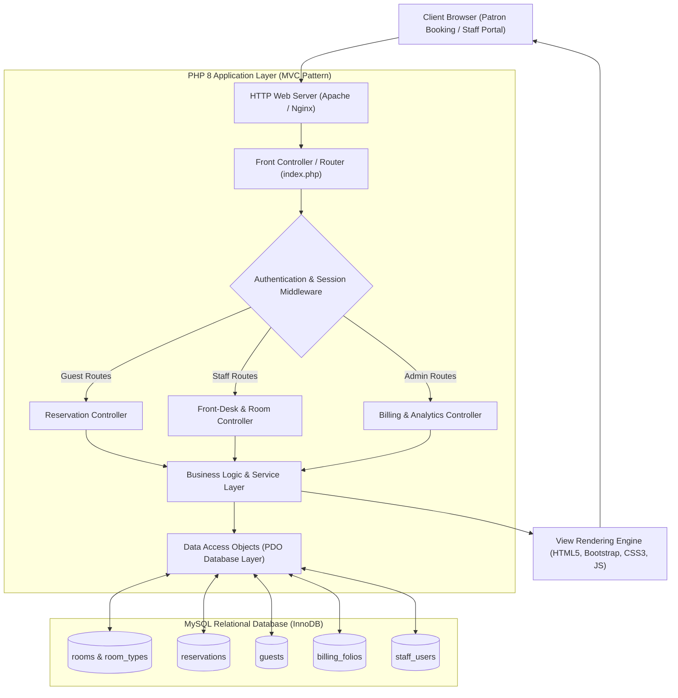

<div align="center">

<!-- Header Banner -->


<p align="center">
  
  
  
  
  
  
</p>

<p align="center">
  <a href="#-system-overview">Overview</a> •
  <a href="#-core-modules--operational-features">Core Modules</a> •
  <a href="#-system-architecture--mvc-dataflow">Architecture</a> •
  <a href="#-relational-database-schema-3nf">Database Schema</a> •
  <a href="#-security--enterprise-hardening">Security</a> •
  <a href="#-local-environment-setup">Installation</a> •
  <a href="#-authors--portfolio">Author</a>
</p>

</div>

---

### 📖 System Overview

The **Enterprise Hotel Management & Guest Reservation System** is a full-stack web application designed for hospitality property management (PMS), reservation automation, room inventory optimization, and point-of-sale guest billing. Engineered with **PHP 8**, **MySQL**, and a modular **MVC architecture**, the platform replaces fragmented manual logbooks with an automated, synchronized digital operations center.

From front-desk check-ins and live room housekeeping statuses to dynamic seasonal room tiering and automated guest folio settlement, the system optimizes administrative throughput while delivering an intuitive, self-service booking experience for patrons.

---

### 🌟 Core Modules & Operational Features

#### 1. 🛎️ Front-Desk & Reservation Engine
- **Live Room Availability Matrix:** Real-time visual calendar displaying occupied, reserved, vacant, and maintenance rooms across selectable date ranges.
- **Reservation Lifecycle:** End-to-end booking state machine managing reservations through `Pending`, `Confirmed`, `Checked-In`, `Checked-Out`, and `Cancelled`.
- **Guest Profiles & CRM:** Centralized customer registry storing national ID/passport numbers, contact records, visit histories, and VIP preferences.

#### 2. 🛏️ Room Inventory & Housekeeping Operations
- **Category Tiering:** Granular configuration of room classes (e.g., *Presidential Suite, Deluxe Ocean-View, Executive Double, Standard Single*) with base pricing, capacity caps, and amenity inclusions.
- **Real-Time Housekeeping Dispatch:** Operational status flags (`Clean`, `Dirty`, `Inspected`, `Out of Order`) allowing housekeeping supervisors to release rooms to front-desk staff immediately upon sanitization.

#### 3. 💳 Guest Folio & Automated Billing Engine
- **Itemized Billing Invoices:** Automatically tallies room tariffs, extra bedding, food & beverage (F&B) room service orders, and recreational amenities into a consolidated guest folio.
- **Tax & Surcharge Calculation:** Dynamic calculation of municipal hospitality taxes, VAT, and service charges.
- **Payment Processing & Invoicing:** Supports cash, credit/debit card, and mobile banking reconciliation with automated PDF/printable receipt generation.

#### 4. 📊 Hospitality Business Analytics
- **Key Hospitality Metrics:** Real-time computation of **RevPAR** (Revenue Per Available Room), **ADR** (Average Daily Rate), and **Occupancy Rates**.
- **Financial Audit Trails:** Shift-change reconciliations and periodic revenue reports for executive review.

---

### 🧠 System Architecture & MVC Dataflow



---

### 🗄️ Relational Database Schema (3NF)

The database schema is normalized to **Third Normal Form (3NF)** with foreign key constraints, indexes, and InnoDB transactional storage:

```
├── staff_users       # Administrative credentials, role-based authorization levels
├── guests            # Guest personal identities, passport/NID, contact information
├── room_types        # Accommodation categories, base pricing, capacities, amenities
├── rooms             # Physical room inventory, floor allocations, housekeeping status
├── reservations      # Check-in/check-out dates, guest associations, status states
├── billing_folios    # Itemized room charges, amenities, taxes, payment settlements
└── folio_items       # Granular line items (room service, laundry, minibar, late checkouts)
```

#### Core Table Definitions

```sql
CREATE TABLE room_types (
    type_id INT AUTO_INCREMENT PRIMARY KEY,
    type_name VARCHAR(100) NOT NULL,
    base_price DECIMAL(10,2) NOT NULL,
    max_adults INT NOT NULL,
    description TEXT,
    created_at TIMESTAMP DEFAULT CURRENT_TIMESTAMP
) ENGINE=InnoDB;

CREATE TABLE rooms (
    room_id INT AUTO_INCREMENT PRIMARY KEY,
    room_number VARCHAR(20) UNIQUE NOT NULL,
    type_id INT NOT NULL,
    floor_number INT NOT NULL,
    status ENUM('AVAILABLE', 'OCCUPIED', 'DIRTY', 'MAINTENANCE') DEFAULT 'AVAILABLE',
    FOREIGN KEY (type_id) REFERENCES room_types(type_id) ON DELETE CASCADE
) ENGINE=InnoDB;

CREATE TABLE guests (
    guest_id INT AUTO_INCREMENT PRIMARY KEY,
    first_name VARCHAR(100) NOT NULL,
    last_name VARCHAR(100) NOT NULL,
    email VARCHAR(150) UNIQUE NOT NULL,
    phone VARCHAR(30) NOT NULL,
    id_card_number VARCHAR(50) NOT NULL,
    address TEXT,
    created_at TIMESTAMP DEFAULT CURRENT_TIMESTAMP
) ENGINE=InnoDB;

CREATE TABLE reservations (
    reservation_id INT AUTO_INCREMENT PRIMARY KEY,
    booking_reference VARCHAR(32) UNIQUE NOT NULL,
    guest_id INT NOT NULL,
    room_id INT NOT NULL,
    check_in_date DATE NOT NULL,
    check_out_date DATE NOT NULL,
    total_amount DECIMAL(10,2) NOT NULL,
    status ENUM('CONFIRMED', 'CHECKED_IN', 'CHECKED_OUT', 'CANCELLED') DEFAULT 'CONFIRMED',
    created_at TIMESTAMP DEFAULT CURRENT_TIMESTAMP,
    FOREIGN KEY (guest_id) REFERENCES guests(guest_id) ON DELETE CASCADE,
    FOREIGN KEY (room_id) REFERENCES rooms(room_id) ON DELETE CASCADE
) ENGINE=InnoDB;

CREATE TABLE billing_folios (
    folio_id INT AUTO_INCREMENT PRIMARY KEY,
    reservation_id INT NOT NULL,
    room_charges DECIMAL(10,2) NOT NULL,
    amenity_charges DECIMAL(10,2) DEFAULT 0.00,
    tax_amount DECIMAL(10,2) NOT NULL,
    total_paid DECIMAL(10,2) NOT NULL,
    payment_method ENUM('CASH', 'CREDIT_CARD', 'DEBIT_CARD', 'ONLINE') NOT NULL,
    paid_at TIMESTAMP DEFAULT CURRENT_TIMESTAMP,
    FOREIGN KEY (reservation_id) REFERENCES reservations(reservation_id) ON DELETE CASCADE
) ENGINE=InnoDB;
```

---

### 🛡️ Security & Enterprise Hardening

- **SQL Injection Prevention:** 100% of database queries execute through **PHP Data Objects (PDO)** utilizing parameterized prepared statements.
- **Cryptographic Credential Security:** User passwords are encrypted using `password_hash()` with the robust **BCrypt** hashing algorithm.
- **Cross-Site Request Forgery (CSRF) Mitigation:** Synchronizer CSRF tokens are injected into all POST/PUT/DELETE forms and validated server-side.
- **Cross-Site Scripting (XSS) Sanitization:** All dynamic user inputs are escaped via `htmlspecialchars(..., ENT_QUOTES, 'UTF-8')` before DOM rendering.
- **Session Security:** Strict session cookies with `HttpOnly`, `SameSite=Strict`, and `Secure` flags prevent session hijacking.

---

### 🚀 Local Environment Setup

#### Prerequisites
- **Web Server:** Apache or Nginx (e.g., via [XAMPP](https://www.apachefriends.org/), [WampServer](https://www.wampserver.com/), or Docker)
- **PHP:** Version 8.0 or higher (with `pdo_mysql` extension enabled)
- **Database:** MySQL 5.7+ or MariaDB 10.4+

#### 1. Clone the Repository
Clone into your local web server's document root (e.g., `C:/xampp/htdocs/` on Windows or `/var/www/html/` on Linux):
```bash
cd /path/to/htdocs
git clone https://github.com/ReaduanulFaridFahim/Hotel-Management-System-.git
cd Hotel-Management-System-
```

#### 2. Configure Database
1. Open your database administration portal (e.g., **phpMyAdmin** at `http://localhost/phpmyadmin`).
2. Create a new relational database:
   ```sql
   CREATE DATABASE hotel_db CHARACTER SET utf8mb4 COLLATE utf8mb4_unicode_ci;
   ```
3. Import the table schema definitions.

#### 3. Set Connection Credentials
Create or update your database configuration in `config.php`:
```php
<?php
define('DB_HOST', 'localhost');
define('DB_USER', 'root');
define('DB_PASS', '');
define('DB_NAME', 'hotel_db');

try {
    $pdo = new PDO("mysql:host=" . DB_HOST . ";dbname=" . DB_NAME . ";charset=utf8mb4", DB_USER, DB_PASS, [
        PDO::ATTR_ERRMODE => PDO::ERRMODE_EXCEPTION,
        PDO::ATTR_DEFAULT_FETCH_MODE => PDO::FETCH_ASSOC,
        PDO::ATTR_EMULATE_PREPARES => false,
    ]);
} catch (PDOException $e) {
    die("Database Connection Error: " . $e->getMessage());
}
?>
```

#### 4. Launch Application
Start Apache and MySQL services, then open your browser:
```
http://localhost/Hotel-Management-System-/
```

---

### 👥 Authors & Portfolio

- **Lead Engineer:** [Readuanul Farid Fahim](https://github.com/ReaduanulFaridFahim)
- **Personal Portfolio:** [https://readuanulfaridfahim.github.io/](https://readuanulfaridfahim.github.io/)

---

<div align="center">


</div>
